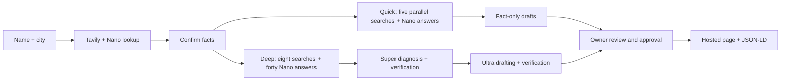

# Cited

Customers ask AI who to visit. Does it say you?

Cited gives local businesses a fast, sourced AI visibility snapshot: five everyday searches, live answers, and fact-only drafts the owner reviews. Optional deep research adds eight questions, forty answers, cited rival explanations and independent verification. Built for the Nebius x NVIDIA Global AI Hackathon.

Live demo: [cited-dev.vercel.app](https://cited-dev.vercel.app). Four fictional examples work without signup or provider keys. Live checks use Nebius Token Factory, Tavily and a dedicated Supabase database.

Video: refreshed narrated demo exported locally at 2:57; public YouTube publishing is on hold at the owner's request. Script: [docs/DEMO_SCRIPT.md](docs/DEMO_SCRIPT.md).

## Run locally

Requires Node.js 22.16+ and npm.

```powershell
npm ci
Copy-Item .env.example .env.local
npm run seed
npm run dev
```

Open http://localhost:3000. Saved fictional examples work without AI API keys. The `/design` route renders the complete design system. Development uses Webpack to avoid a Windows Turbopack Google-font query issue; the production build uses Turbopack.

Configure Supabase and provider keys to enable live checks. Apply [001_cited.sql](supabase/migrations/001_cited.sql) followed by [002_quick_checks.sql](supabase/migrations/002_quick_checks.sql), set `.env.local`, then seed again. Deployment requires Supabase persistence, a trusted `NEXT_PUBLIC_SITE_URL`, and allowed Auth callback URLs. Never place API keys in client variables.

## How we use Nemotron and Nebius Token Factory

All runtime model calls use the OpenAI-compatible Token Factory endpoint. Authenticated model-catalog verification returned these exact IDs:

| Role     | NVIDIA model                            | Runtime job                                                         |
| -------- | --------------------------------------- | ------------------------------------------------------------------- |
| Fast     | `nvidia/NVIDIA-Nemotron-3-Nano-30B-A3B` | Business lookup, five quick answers, or forty deep answers          |
| Reasoner | `nvidia/nemotron-3-super-120b-a12b`     | Cited rival diagnosis and independent verification in deep research |
| Writer   | `nvidia/Nemotron-3-Ultra-550b-a55b`     | Draft fixes and independently verify their confirmed facts          |

IDs live in environment variables. The client has retries, timeouts, JSON parsing, Zod validation, and token-usage logs. Catalog availability is verified; runtime inference results are recorded separately in [docs/ACCEPTANCE.md](docs/ACCEPTANCE.md).

## How we use Tavily

Lookup and quick checks use Tavily basic search excerpts. Deep research uses advanced Search followed by Extract on the top source pages. It stores source URLs, excerpts and fetch timestamps. Citations must point to stored fetched sources. Provider failures are shown explicitly and never replaced with samples. See [verified documentation](docs/INTEGRATIONS.md).

## Architecture



The immediate on-page quick flow uses real progress, streams saved answers independently of worker requests, and provides recovery without losing completed work. Quick jobs start after the creation response and continue if the panel closes. See the [product audit and measured timing](docs/PRODUCT_AUDIT.md) and [logo prompt/provenance](docs/LOGO.md).

Detailed design, persistence and classification rules: [docs/ARCHITECTURE.md](docs/ARCHITECTURE.md).

## Environment variables

| Variable                                    | Purpose                                         |
| ------------------------------------------- | ----------------------------------------------- |
| `NEBIUS_API_KEY`                            | Token Factory key, server only                  |
| `NEBIUS_BASE_URL`                           | `https://api.tokenfactory.nebius.com/v1/`       |
| `MODEL_FAST`, `MODEL_REASON`, `MODEL_WRITE` | Exact authenticated catalog IDs                 |
| `TAVILY_API_KEY`                            | Runtime search and extraction, server only      |
| `NEXT_PUBLIC_SUPABASE_URL`                  | Dedicated Cited project URL                     |
| `NEXT_PUBLIC_SUPABASE_PUBLISHABLE_KEY`      | Public Auth key; legacy anon key also supported |
| `SUPABASE_SERVICE_ROLE_KEY`                 | Server-only persistence key                     |
| `NEXT_PUBLIC_SITE_URL`                      | Trusted deployed origin                         |
| `CRON_SECRET`                               | Worker Bearer secret                            |
| `CITED_LOCAL_STORE`                         | `true` for local development only               |

## Verify

```powershell
npm run verify:threeui
npm test
npm run typecheck
npm run test:e2e
npm run build
npm run smoke:integrations
```

Playwright uses installed Chrome. Tests cover desktop/mobile, sample reports, zero mentions, unconfirmed-fact rejection, approval, public sample pages, reduced motion, accessibility, and isolation between sessions. Set `CITED_TEST_URL` to test a deployed origin. Unit and PostgreSQL tests cover scoring, Unicode names, citation integrity, fact locks, exclusive leases, owner transfers, atomic quotas and weekly scheduling. The migration independently enforces citation and completed-report constraints.

## Rechecks

Every report offers Recheck now. A Bearer-protected `/api/worker` endpoint advances queued live checks and due weekly rechecks. The included GitHub Actions workflow runs every fifteen minutes, with three worker requests per invocation; configure its `CITED_SITE_URL` variable and `CRON_SECRET` secret. Foreground polling also advances work. Do not expose the secret in query strings. Weekly scheduling is opt-in; no automatic submissions to other platforms occur.

Judge access has no payment gate. Keeping it available through December 15 requires retaining the deployment, database and provider credits. Magic-link account saving requires custom SMTP in Supabase; running checks and exploring examples do not require an email account.

## Honest by design

- No source, no claim. Findings without citations are rejected.
- Quick checks are explicitly single-pass snapshots. Deep checks show five runs per question, never a made-up percentage.
- Fact lock. Fixes use only confirmed business facts.
- Owner approves everything. Approval unlocks final copying and public pages.
- Outlooks state what is unlikely. They are heuristics, not guarantees.
- Scores from Nemotron plus web search. Not live ChatGPT results.
- Sample data always has a visible badge and uses fictional businesses.

## Visual implementation

Space Grotesk headings and body text, JetBrains Mono details, black editorial surfaces and a copper accent. The generated C/citation logo is shared by the header, footer and favicon. The user-directed refinement removes repeated navigation actions and decorative feature clutter. GSAP handles entry and scroll reveals with reduced-motion support. The hero background covers the entire hero and compiles the exact registered Predictive Arc source, preserving all sixteen requested files and their SHA-256 hashes. [Design decisions](docs/DESIGN_DECISIONS.md) and [source provenance](docs/INTEGRATIONS.md#threeui-source-provenance).

MIT for Cited code. ThreeUI and bundled fonts retain [their notices](vendor/threeui/THIRD_PARTY_NOTICES.md). Agency mode and other post-hackathon features are deferred.
