# Cited

Customers ask AI who to visit. Does it say you?

Cited gives local small businesses an honest visibility check: eight customer questions, five independent answers each, cited explanations, and fixes approved by the owner. Built for the Nebius x NVIDIA Global AI Hackathon.

Live demo: pending deployment and storage configuration.

Video: pending recording and public YouTube upload. Script: [docs/DEMO_SCRIPT.md](docs/DEMO_SCRIPT.md).

## Run locally

Requires Node.js 22.16+ and npm.

```powershell
npm ci
Copy-Item .env.example .env.local
npm run seed
npm run dev
```

Open http://localhost:3000. Saved fictional examples work without AI API keys. The `/design` route renders the complete design system. Development uses Webpack to avoid a Windows Turbopack Google-font query issue; the production build uses Turbopack.

Configure Supabase and provider keys to enable live checks. Apply [supabase/migrations/001_cited.sql](supabase/migrations/001_cited.sql), set `.env.local`, then seed again. Deployment requires Supabase persistence, a trusted `NEXT_PUBLIC_SITE_URL`, and allowed Auth callback URLs. Never place API keys in client variables.

## How we use Nemotron and Nebius Token Factory

All runtime model calls use the OpenAI-compatible Token Factory endpoint. Authenticated model-catalog verification returned these exact IDs:

| Role     | NVIDIA model                            | Runtime job                                                |
| -------- | --------------------------------------- | ---------------------------------------------------------- |
| Fast     | `nvidia/NVIDIA-Nemotron-3-Nano-30B-A3B` | Five independent recommendations for each question         |
| Reasoner | `nvidia/nemotron-3-super-120b-a12b`     | Business resolution, questions, cited rival diagnosis      |
| Writer   | `nvidia/Nemotron-3-Ultra-550b-a55b`     | Prioritize fixes and verify drafts against confirmed facts |

IDs live in environment variables. The client has retries, timeouts, JSON parsing, Zod validation, and token-usage logs. Catalog availability is verified; runtime inference results are recorded separately in [docs/ACCEPTANCE.md](docs/ACCEPTANCE.md).

## How we use Tavily

The live flow calls Tavily Search for business identity and every customer question, then Extract on the top source pages. It stores source URLs, excerpts and fetch timestamps. Citations must point to stored fetched sources. Provider failures are shown explicitly and never replaced with samples. See [verified documentation](docs/INTEGRATIONS.md).

## Architecture

```mermaid
flowchart LR
  Input[Name + city] --> Tavily[Tavily search + extract]
  Tavily --> Confirm[Confirm facts]
  Confirm --> Queue[Supabase queue]
  Queue --> Nano[Nemotron Nano x40]
  Nano --> Super[Super diagnosis]
  Super --> Ultra[Ultra verified fixes]
  Ultra --> Approve[Owner approval]
  Approve --> Page[Hosted page + JSON-LD]
```



Detailed design, persistence and classification rules: [docs/ARCHITECTURE.md](docs/ARCHITECTURE.md).

## Environment variables

| Variable                                    | Purpose                                    |
| ------------------------------------------- | ------------------------------------------ |
| `NEBIUS_API_KEY`                            | Token Factory key, server only             |
| `NEBIUS_BASE_URL`                           | `https://api.tokenfactory.nebius.com/v1/`  |
| `MODEL_FAST`, `MODEL_REASON`, `MODEL_WRITE` | Exact authenticated catalog IDs            |
| `TAVILY_API_KEY`                            | Runtime search and extraction, server only |
| `NEXT_PUBLIC_SUPABASE_URL`                  | Dedicated Cited project URL                |
| `NEXT_PUBLIC_SUPABASE_ANON_KEY`             | Public Auth key                            |
| `SUPABASE_SERVICE_ROLE_KEY`                 | Server-only persistence key                |
| `NEXT_PUBLIC_SITE_URL`                      | Trusted deployed origin                    |
| `CRON_SECRET`                               | Worker Bearer secret                       |
| `CITED_LOCAL_STORE`                         | `true` for local development only          |

## Verify

```powershell
npm run verify:threeui
npm test
npm run typecheck
npm run test:e2e
npm run build
npm run smoke:integrations
```

Playwright uses installed Chrome. Tests cover desktop/mobile, sample reports, zero mentions, unconfirmed-fact rejection, approval, public sample pages, reduced motion, accessibility, and isolation between sessions. Unit tests cover scoring, Unicode names, citation integrity and fact locks. The migration adds independent DB citation constraints.

## Rechecks

Every report offers Recheck now. A Bearer-protected `/api/worker` endpoint advances queued live checks and due weekly rechecks. Configure an external scheduler every minute for durable background progress. Do not expose the secret in query strings. Weekly scheduling is opt-in; no automatic submissions to other platforms occur.

## Honest by design

- No source, no claim. Findings without citations are rejected.
- Repeat, then report. Five runs appear as five dots, never a made-up percentage.
- Fact lock. Fixes use only confirmed business facts.
- Owner approves everything. Approval unlocks final copying and public pages.
- Outlooks state what is unlikely. They are heuristics, not guarantees.
- Scores from Nemotron plus web search. Not live ChatGPT results.
- Sample data always has a visible badge and uses fictional businesses.

## Visual implementation

Black canvas, graphite hairlines, Inter UI, Playfair Display hero, JetBrains Mono receipts, ghost buttons and one violet accent. GSAP handles entry and scroll reveals with reduced-motion support. The hero compiles the exact registered Predictive Arc source, preserving all sixteen requested files and their SHA-256 hashes. [Provenance and asset notes](docs/INTEGRATIONS.md#threeui-source-provenance).

MIT for Cited code. ThreeUI and bundled fonts retain [their notices](vendor/threeui/THIRD_PARTY_NOTICES.md). Agency mode and other post-hackathon features are deferred.
