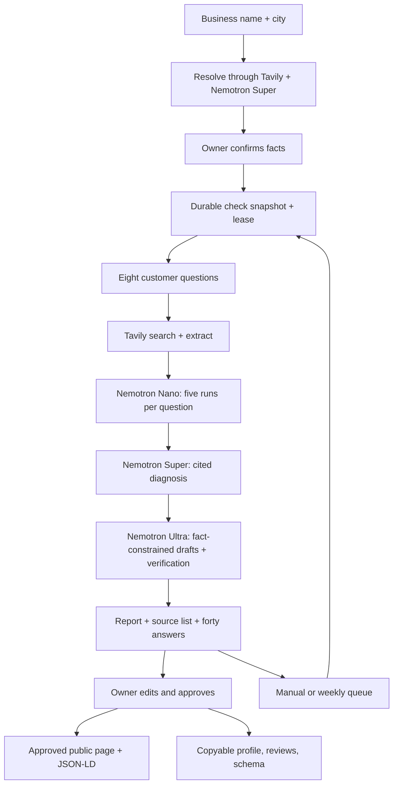

# Architecture

## Persistence and queue

Supabase `records` stores complete snapshots. A transactional trigger mirrors checks into the normalized tables in the plan. A DB constraint rejects findings with empty citations, and a trigger rejects citation IDs without a corresponding fetched source. Completed snapshots require eight questions with exactly five runs each.

The worker takes a six-minute lease using a database row lock and advances one unit of work per foreground request. Each individual model call has a timeout, bounded retries and Zod validation. Polling drives foreground checks; an authenticated worker endpoint also advances queued work. A lost or interrupted browser does not lose saved answers. Provider failures create an explicit error state, never a fabricated score. The owner can resume a failed stage up to three times without discarding completed answers. Stale lease holders cannot overwrite newer work or a transferred report owner.

For local development, `.data` provides durable JSON snapshots, atomic rename, and a process-local mutation queue. It is unsuitable for distributed production. Production refuses local storage unless explicitly enabled. Use Supabase for deployed judges’ reports.

## Identity and permissions

First check uses a high-entropy HttpOnly cookie hashed on the server, without signup. Magic-link login is optional after results. Supabase validates the signed-in identity through `getUser`, and the callback claims anonymous reports into that account. The Next.js proxy refreshes existing Auth sessions through `getClaims` and preserves cookie response headers. Public hosted pages are separately snapshotted only after approval. Editing approved fixes is locked. Browser cross-origin writes are rejected.

## Honest generation

Visibility answers receive source excerpts but not the target name, to reduce target bias. Mentions are detected from the actual recommendation list using Unicode-normalized exact names. Incidental mentions in prose do not count. Classification is documented in `honesty.ts`: missing evidence or fewer than five runs means Needs your check; 2+ mentions means Winnable now; 1 mention or a niche zero means In about 3 months; broad zero means Unlikely. These labels are heuristics rather than guarantees.

The Writer model drafts fixes from confirmed facts and performs an independent verification pass. Drafts failing deterministic fact checks fall back to fact-derived templates, which also pass verification. Editing outside confirmed values is flagged, and approval rejects the change. Schema edits must retain the fact-derived object. Nothing is copied as final or published before the owner taps Approve. Cited diagnoses receive a separate Reasoner entailment pass against fetched excerpts before display.

## Examples and future scope

Four fictional examples are seeded into the same store, covering the United States, United Kingdom, Australia and Canada. They remain labeled Sample data, use authored fictional source pages, and have independent per-session approval state. Sample public pages are noindex and omit LocalBusiness JSON-LD to avoid representing fictional shops as real entities.

Agency switching, white-label reports, lead tracking, niche blog posts, and GitHub PR integrations are intentionally deferred. Paid tiers are planned prices only. There is no payment collection.
